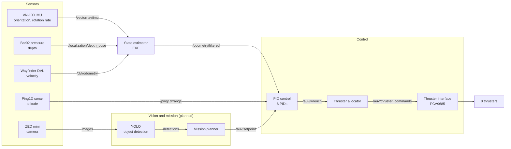

# Architecture Overview

How the AUV software fits together, from sensors to thrusters. This is the big-picture map. Each package and sensor has its own README or doc with the details, linked at the bottom.

New to ROS2 terms like node, topic, or message? Read `docs/concepts/ros-basics.md` first.

---

## The pipeline in one picture



Pressure and DVL inputs to the EKF are written but not enabled yet (see Stage 2). The mission planner does not exist yet, so for now `/auv/setpoint` comes from a manual test publisher.

The loop runs continuously, many times per second:
**sense → estimate → compare to goal → correct → move thrusters → sense again.**

---

## Stage 1: Sensors

Each sensor has its own driver node that talks to the hardware and publishes a standard ROS message. No sensor knows the full picture. Each measures one slice.

| Sensor | What it measures | Package | Topic | Where it goes | Status |
|---|---|---|---|---|---|
| **VN-100** (IMU/AHRS) | Orientation (roll, pitch, yaw) and rotation rate | `auv_vn100` | `/vectornav/imu` | EKF | Working, ~39 Hz |
| **Bar02** (pressure) | Water pressure, converted to depth | `auv_pressure` | `/pressure/fluid_pressure`, `/localization/depth_pose` | EKF (`pose0`, not enabled yet) | Written, not water-tested |
| **Wayfinder DVL** | Velocity over the ground (bottom lock) | `auv_dvl` | `/dvl/odometry` | EKF (`odom0`, not enabled yet) | Written, axes need verifying |
| **Ping1D sonar** | Distance to the bottom (altitude) | `auv_ping` | `/ping1d/range`, `/ping1d/confidence` | PID control directly | Working in air only |
| **ZED mini** (camera) | Images | `zed-ros2-wrapper` | ZED image topics | YOLO | SDK not installed yet |

**Why the sensors complement each other:**
- The IMU is fast and accurate for rotation, but can't tell position or depth.
- Pressure gives absolute depth, but nothing about horizontal motion.
- The DVL gives velocity, but not position or orientation.
- Sonar gives height above the bottom, which pressure can't (the pool floor depth is unknown).

Key conventions:
- **Frames:** all data is expressed in ROS standard ENU (x forward, y left, z up). Sensors are mounted in odd orientations, so each has a **static TF** in `bringup.launch.py` (`vectornav_mount_tf`, `dvl_mount_tf`) that tells ROS how it's rotated relative to the vehicle (`base_link`).
- **Stable device names:** USB-serial sensors get a udev symlink (`/dev/vectornav`, `/dev/ping1d`, `/dev/dvl`) so their port never changes. See `docs/concepts/udev-rules.md`.
- **Depth vs altitude:** *depth* is distance below the surface (pressure, goes into the EKF). *Altitude* is distance above the floor (sonar, goes straight to control). They are not interchangeable.

---

## Stage 2: State estimator (`auv_localization`)

Raw sensors are noisy and each only sees a piece. The **state estimator** blends them into one best guess of the vehicle's state: orientation, depth, velocity. We use `robot_localization`'s **EKF** (Extended Kalman Filter).

**The Kalman filter idea, in plain words:**
1. **Predict:** use a model of how the vehicle moves to guess where it is now.
2. **Update:** when a sensor reading arrives, compare it to the guess and nudge the guess toward it.
3. **Trust each source by its noise:** a precise sensor pulls the estimate harder than a noisy one. These trust levels are the covariance values in `ekf.yaml`.

Result: smoother and more reliable than any single sensor, and it keeps working briefly if one drops out.

**Configured in** `auv_localization/config/ekf.yaml`:

| Input | Config key | Fuses | Status |
|---|---|---|---|
| VN-100 IMU | `imu0` | Orientation + angular velocity (acceleration deliberately excluded, it caused position drift) | **Active** |
| Pressure depth | `pose0` | Depth (z) | Commented out, enable after water test |
| DVL | `odom0` | Linear velocity | Commented out, enable after yaw alignment is verified |

**Output:** `/odometry/filtered` (`nav_msgs/Odometry`). This is the single source of truth for "where is the vehicle" that control reads.

Details and tuning notes: `auv_localization/README.md`. Background: `docs/concepts/kalman-filter.md`.

---

## Stage 3: Setpoints (what we want)

A **setpoint** is the target state the controller tries to reach. It is published on `/auv/setpoint` using our custom `auv_msgs/Setpoint` message:

| Field | Meaning |
|---|---|
| `desired_pose` | Target roll, pitch, yaw (orientation) and `position.z` (target depth, or target altitude in hold mode) |
| `desired_velocity` | Target forward speed (surge) |
| `use_altitude_hold` | `false`: `position.z` is **depth** below the surface. `true`: `position.z` is **altitude** above the floor |

Something has to publish setpoints. Today that is a manual test publisher (`publish_setpoint`). Eventually it is the mission planner, so a mission is just "a sequence of setpoints."

---

## Stage 4: Control (`auv_control`)

Three nodes, started together by `control.launch.py`:

### 4a. PID control (`pid_control_node`)
Compares the **estimate** (`/odometry/filtered`) to the **setpoint** and computes a correction. It runs six PID controllers:

| PID | Holds | Error is based on |
|---|---|---|
| Roll | Level side-to-side | Orientation (radians) |
| Pitch | Level front-to-back | Orientation (radians) |
| Yaw | Heading | Orientation (radians, angle-wrapped) |
| Depth | Depth below surface | Odometry z (meters) |
| Altitude | Height above floor | `/ping1d/range` (meters), used instead of depth when `use_altitude_hold` |
| Surge | Forward speed | Velocity (no absolute x/y position exists) |

- **P** pushes in proportion to the error, **I** removes lingering offset, **D** damps overshoot. Tune in the order P, D, then I. See `docs/concepts/pid.md`.
- Gains live in `config/pid_gains.yaml`. They are all `0.0` placeholders until tuned.

**Output:** `/auv/wrench`, a combined "push this way, twist that way" command. We use it as a normalized **-1 to 1** value per axis, not real Newtons.

### 4b. Thruster allocator (`thruster_allocator_node`)
Converts the wrench into one command per thruster, using a sign table that encodes which way each thruster pushes for surge, heave, yaw, roll, and pitch. Output is a servo angle: `90° (neutral) ± gain × value`, clamped to 60–120°. Published on `/auv/thruster_commands`.

Safety gates: `YAW/ROLL/PITCH_MIXING_VERIFIED` flags default to `False`. **Only flip one to `True` after the matching physical bench test.** The sign tables stay in code, not YAML, on purpose, because they are hardware facts.

### 4c. Thruster interface (`thruster_interface_node`)
Writes the angles to the PCA9685 PWM board over I2C (`adafruit_servokit`). Returns all thrusters to neutral on shutdown.

### Thruster layout
8 thrusters, all axis-aligned. **A = left (port), M = right (starboard).** Horizontal: A1, A4, M1, M4 (A4/M4 front, A1/M1 back). Vertical: A2, A3, M2, M3. Full table and runbook: `auv_control/README.md`, `docs/sessions/2026-09-05-first-thruster-test-and-tuning.md`.

---

## Stage 5: Vision and mission (the camera path)

The camera answers a different question from the sensors above. Not "where am I?" but "what do I need to do next?"

```
ZED mini ──images──► YOLO (yolo_ros) ──detections──► Mission planner ──► /auv/setpoint
```

1. **ZED mini** publishes camera images.
2. **YOLO** (via the `yolo_ros` wrapper) is a trained object-detection model. It finds task objects (gate, buoy, markers) in each image and outputs their class and position in the frame.
3. **Mission planner** (`auv_mission`) turns detections into goals. For example, "gate is left of center" becomes "yaw a few degrees left, move forward." Those goals are published as setpoints.
4. From there the control loop above does the work. **Vision never commands thrusters directly. It only changes the setpoint.**

**Status:** `auv_vision` and `auv_mission` are not built yet. YOLO needs torch and torchvision on the Jetson. torch is installed, torchvision is a handoff item: `docs/issues/torchvision-jetson-handoff.md`. The ZED SDK is also not installed (`zed-ros2-wrapper` is `COLCON_IGNORE`d for now).

---

## Stage 6: Starting it all (`auv_bringup`)

`auv_bringup/launch/bringup.launch.py` starts everything in one command:

```bash
ros2 launch auv_bringup bringup.launch.py
```

It launches the sensor drivers, the static TF mounts, localization, and `control.launch.py`. The ZED stays commented out until its SDK is installed.

---

## Packages at a glance

| Package | Role |
|---|---|
| `auv_msgs` | Shared custom messages (`Setpoint`, `ThrusterCommands`) |
| `auv_vn100` | IMU driver |
| `auv_pressure` | Depth sensor driver |
| `auv_dvl` | DVL driver |
| `auv_ping` | Sonar altitude driver |
| `auv_localization` | EKF configuration |
| `auv_control` | PID, thruster allocation, thruster hardware interface |
| `auv_vision` | YOLO detections (planned) |
| `auv_mission` | Task logic, publishes setpoints (planned) |
| `auv_bringup` | Launch files that start everything |

---

## What's done and what's next

| Area | State |
|---|---|
| VN-100 → EKF orientation | Working |
| Ping sonar driver | Working in air, water test pending |
| Pressure and DVL drivers | Written, need water tests and sign/axis checks |
| EKF depth and DVL inputs | Disabled until the sensors are verified |
| PID gains | Placeholders, tune after thruster bench sign checks |
| Thruster mixing (yaw/roll/pitch) | Unverified, gated by flags |
| YOLO / camera | Blocked on torchvision and ZED SDK |
| Mission planner | Not started |

Open issues live in `docs/issues/`.

---

## Where to read next

- Sensor setup: `docs/sensors/` (`vn100.md`, `ping-sonar.md`, `pressure-sensor.md`, `dvl.md`)
- Concepts: `docs/concepts/` (ROS basics, Kalman filter, PID, Euler vs quaternions, udev)
- Package READMEs: `auv_control/README.md`, `auv_localization/README.md`
- Build order and bring-up stages: `docs/architecture-roadmap.md`
- Commands and debugging: `docs/references/`
